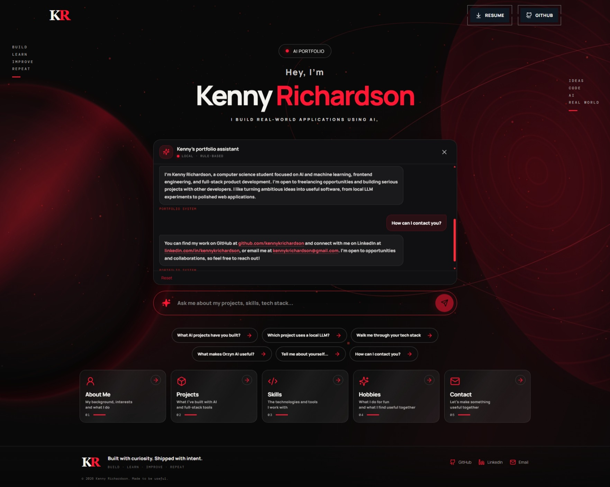

::: {align="center"}
# 👋 Kenny Richardson

### 🚀 AI Engineer • Full-Stack Developer

**Building useful software at the intersection of AI, engineering, and
thoughtful design.**

I build intelligent applications, developer tools, desktop experiences,
and interactive web projects.

🌐 **[Explore My AI
Portfolio](https://kennykrichardson-ai.onrender.com)**
:::

------------------------------------------------------------------------

## 🛠️ Tech Stack

### 💻 Frontend & UI

-   ⚛️ React
-   📘 TypeScript
-   ⚡ Vite
-   🎨 Tailwind CSS
-   🎭 Framer Motion

### 🌌 3D & Graphics

-   🧊 Three.js
-   🎮 React Three Fiber
-   ✨ React Three Drei

------------------------------------------------------------------------

## 🚀 Featured Projects

### ✍️ Lexyra AI

An AI-powered writing assistant that transforms rough drafts into clear,
meaningful writing while preserving the writer's voice and tone.

### 🤖 Orzyn AI

A developer intelligence platform focused on repository analytics and
engineering insights.

### ♻️ Regenesis AI

A developer repository recreation platform designed to help reconstruct
useful project context.

### 🌍 Nyxora AI

A fine-tuned, LLM-powered world generator built to help writers explore
and create story worlds.

### 💸 Quartly

A personal finance tracker with modern analytics and budgeting features.

### 📊 Fluid Deck AI

An AI-powered PowerPoint parser exploring presentation intelligence and
document automation.

### 📸 FlashText

An OCR-powered application that extracts text from images.

------------------------------------------------------------------------

## Screenshots

### Nexus Page

------------------------------------------------------------------------

## 📬 Connect With Me

Have an idea, collaboration, or opportunity in mind? Let's connect.

-   📧 **Email:** <kennykrichardson@gmail.com>
-   💼 **LinkedIn:**
    [linkedin.com/in/kennykrichardson](https://linkedin.com/in/kennykrichardson)
-   🐙 **GitHub:**
    [github.com/kennykrichardson](https://github.com/kennykrichardson)

------------------------------------------------------------------------

## ©️ Copyright

This project is the intellectual property of **Kenny Richardson**. All
rights reserved.

The source code, design, assets, branding, and content may not be
copied, redistributed, modified, or used without explicit written
permission.

------------------------------------------------------------------------

::: {align="center"}
### ⭐ Thanks for stopping by!

**Build • Learn • Improve • Repeat**
:::
